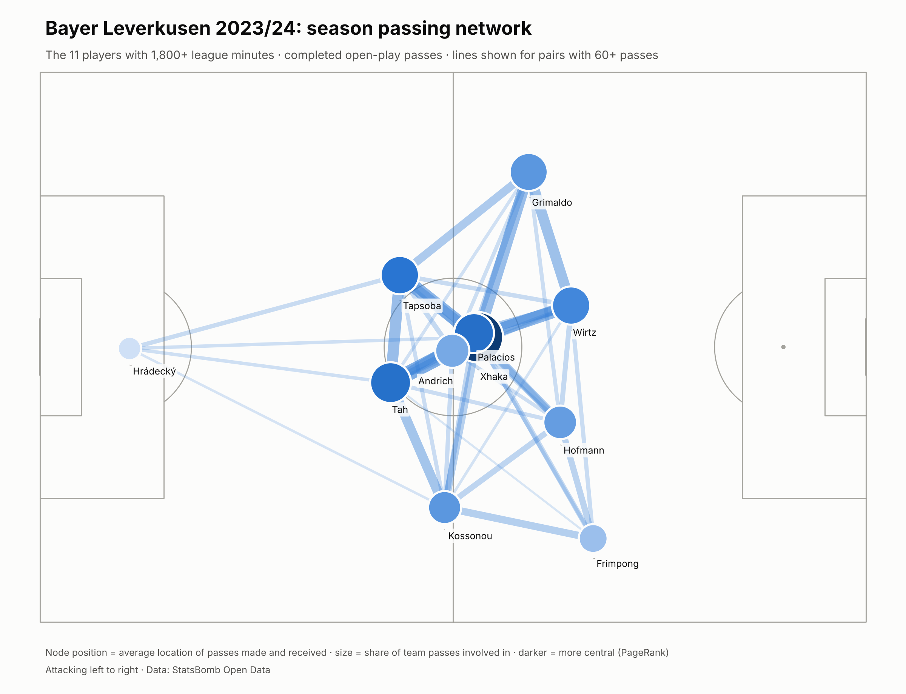
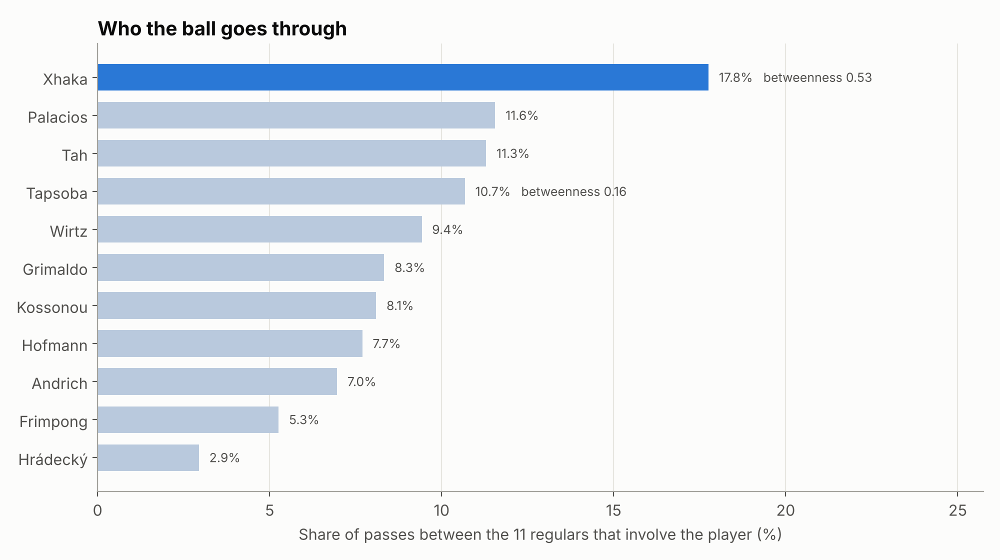
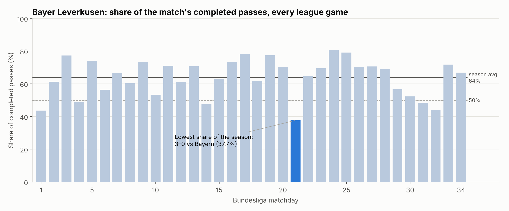
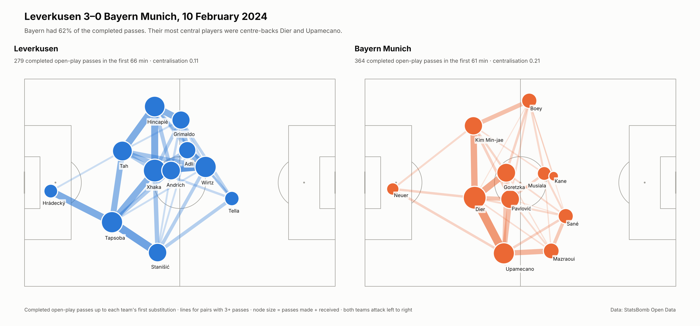
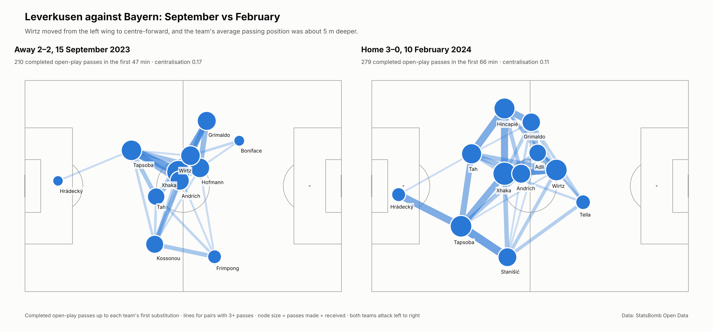

# Passing networks: how Bayer Leverkusen moved the ball in 2023/24

Leverkusen went the 2023/24 Bundesliga season unbeaten (28 wins, 6 draws). This project uses
StatsBomb's free event data, all **39,214 passes** from their 34 league matches, to answer:

1. **What does their passing network look like, and who's the hub?**
2. **Which players connect the team**, measured with network centrality?
3. **How did they beat Bayern 3–0** while having the least of the ball all season?
4. **What changed** between the 2–2 against Bayern in September and the 3–0 in February?

It's the second project in my football analytics portfolio. Like
[Project 1](https://github.com/TilakHeble/football-shot-map), the data lives in **DuckDB**, every
calculation is a **SQL query**, and graph metrics (betweenness, PageRank) are computed with **networkx**.



## Key findings

**1. Granit Xhaka was the hub of the team.**
He made or received **28.9% of all Leverkusen's completed open-play passes**, and made 88 per 90
minutes. In the network of the 11 regulars, his **betweenness is 0.53**: he sits on the strongest
passing route between 53% of all pairs of teammates. Only one other player is above 0.05
(Tapsoba, 0.16). The busiest connection of the season was Xhaka ↔ Palacios (792 passes).



| Player | Minutes | Passes made /90 | Progressive /90 | Involvement* | Betweenness | PageRank |
|---|---:|---:|---:|---:|---:|---:|
| Granit Xhaka | 3,035 | 88.3 | 5.3 | 28.9% | 0.53 | 0.17 |
| Jonathan Tah | 2,848 | 64.1 | 2.5 | 18.4% | 0.04 | 0.11 |
| Exequiel Palacios | 1,897 | 86.3 | 5.2 | 17.5% | 0.00 | 0.11 |
| Edmond Tapsoba | 2,263 | 68.2 | 4.8 | 16.0% | 0.16 | 0.10 |
| Florian Wirtz | 2,529 | 52.7 | **7.3** | 15.9% | 0.00 | 0.09 |
| Alejandro Grimaldo | 2,995 | 45.4 | 4.4 | 15.6% | 0.00 | 0.08 |

\* share of all the team's completed open-play passes the player made or received.
Wirtz is less involved than the midfielders but makes the most **progressive** passes (7.3 per 90).

**2. They dominated the ball, but didn't need it.**
On average Leverkusen had **64% of the completed passes** in their matches (628 per game at 87.6%
accuracy, against 352 at 79.0% for opponents). Their lowest share of the season was the
**3–0 win over Bayern: 37.7%**.



In the 6 matches where they had under half of the passes (all against top-half sides: Leipzig, Bayern ×2,
Stuttgart ×2, Frankfurt), they still went unbeaten (3 wins, 3 draws). But those games were harder:
opponents averaged **1.70 xG**, against **0.63** when Leverkusen had the ball more. Half of their 6
draws came in these games. The Bayern 3–0 is the striking exception: few passes, a comfortable win
on xG (1.0 vs 0.6).

**3. In the 3–0, Bayern had the ball, but it went round their back line.**
Bayern's most central players by PageRank were **centre-backs Eric Dier and Dayot Upamecano**.
Their network was twice as centralised as Leverkusen's (0.21 vs 0.11). Leverkusen spread the work
across a back three, two wing-backs and a double pivot, with no single dominant passer.



**4. Against the same opponent, Leverkusen changed shape.**
In September's 2–2, Wirtz played on the left wing with Boniface up front. In February, with
Boniface not playing, **Wirtz played as the centre-forward**. Hincapié (left centre-back) and
Stanišić (right wing-back) came in for Kossonou and Frimpong, and the team's average passing
position was about **5 m deeper** (outfield node x: 60.8 → 55.4).



## Method

- **Passes in a network** are *completed, open-play* passes. Corners, free kicks, throw-ins, goal kicks
  and kick-offs are excluded so set-piece routines don't distort the shape.
- **Match networks** stop at the team's **first substitution or red card**, so the same 11 players are
  on the pitch throughout (the standard approach). The cut-off is in each chart's subtitle.
- **Node position** = average location of the passes a player made *and* received. **Node size** =
  passes made + received. **Line width** = completed passes between the pair, in both directions.
- **Season network** = the 11 players with 1,800+ league minutes, a natural "season XI".
- **Minutes played** come from lineup data: on at kick-off or as a substitute, off when substituted
  or sent off. StatsBomb's clock restarts at 45:00 after half-time, so second-half times are converted
  to elapsed time. Check: every team's total is about 11 × match length, and lower only where a red
  card was shown.
- **Network metrics** (`src/network.py`, networkx):
  - *Betweenness*: share of shortest paths between teammates that pass through a player. Path
    "distance" = 1 / passes, so frequent pairs are close.
  - *PageRank*: importance from being connected to other important players.
  - *Centralisation* (Freeman, on weighted degree): 0 = everyone equally involved, 1 = one player
    involved in everything.
- **Progressive pass**: ends at least 25% closer to the centre of the opponent's goal than it started,
  and ends in the opponent's half.

## How it's built: SQL first

The raw data is loaded into a **DuckDB** database (`data/statsbomb_passes.duckdb`) with five tables:
`matches`, `passes`, `appearances` (lineup stints), `clock` (half lengths) and `shots`.

| Query | What it does | SQL used |
|---|---|---|
| `01_minutes_played` | Minutes per player per match from lineup stints | CTEs, `CASE`, conditional `MIN`, `arg_min` |
| `02_pass_features` | Elapsed time, completed / open-play / progressive flags | `JOIN`, `CASE`, geometry |
| `03_first_substitution` | When each team first changed personnel | `GROUP BY`, `LIKE` filters |
| `04_match_nodes` | Node positions and sizes for one match | CTE, `UNION ALL` (passes made + received) |
| `05_match_edges` | Passes between each pair for one match | `LEAST`/`GREATEST` to merge directions |
| `06_season_nodes` | Season profile: per-90s, progressive passes, involvement share | CTEs, `CROSS JOIN`, `mode()` |
| `07_season_edges` | Season passing pairs | `GROUP BY` |
| `08_match_summary` | Passes, completion, pass share, goals, xG for every match | CTEs, window `SUM() OVER (PARTITION BY)` |

Example: the passing pairs for a match, with both directions counted together:

```sql
SELECT
    least(f.player, f.recipient)    AS player_a,
    greatest(f.player, f.recipient) AS player_b,
    count(*)                        AS passes
FROM pass_features AS f
JOIN first_change AS fc USING (match_id, team)
WHERE f.match_id = $match_id AND f.team = $team
  AND f.is_complete AND f.is_open_play
  AND f.elapsed < fc.cutoff_elapsed          -- stop at the first substitution
  AND f.recipient IS NOT NULL
GROUP BY player_a, player_b
ORDER BY passes DESC;
```

**Checks:** I independently recounted the February Bayern network straight from the raw StatsBomb
events in pandas (279 passes, same top pairs), and Xhaka's 28.9% involvement across all 34 matches.
The centralisation function returns exactly 1.0 for a star network and 0.0 for an evenly spread one.

## Project structure

```
├── run.py                  # builds every figure and prints the tables above
├── sql/                    # all data logic, one query per file (01-08)
├── src/
│   ├── database.py         # download StatsBomb data into DuckDB
│   ├── queries.py          # runs sql/*.sql with named parameters -> DataFrames
│   ├── network.py          # networkx: betweenness, PageRank, centralisation
│   └── plots.py            # mplsoccer pitch drawings and charts (drawing only)
├── notebooks/
│   └── 02_passing_networks.ipynb   # walkthrough showing each query and its result
├── data/statsbomb_passes.duckdb    # the database (3 MB, included so it runs offline)
└── figures/
```

## How to run

```bash
pip install -r requirements.txt
python run.py              # all figures + tables
python run.py --rebuild    # re-download from StatsBomb first (a couple of minutes)
```

Requires Python 3.10+.

## Limitations and next steps

- **Average positions hide movement.** A node is where a player *tends* to pass from, not where they
  stand. Players who rotate (Xhaka, Palacios and Andrich) can overlap.
- **Only completed passes.** Failed passes, carries and dribbles aren't in the network.
- **Only Leverkusen's 34 matches** are in the open data, so opponents appear once or twice each.
- **Next:** weight passes by the threat they add (expected threat, Project 5) instead of counting
  them equally, and compare networks in wins vs draws.

---
Data: [StatsBomb Open Data](https://github.com/statsbomb/open-data). Built with
[DuckDB](https://duckdb.org), [`statsbombpy`](https://github.com/statsbomb/statsbombpy),
[`mplsoccer`](https://mplsoccer.readthedocs.io) and [networkx](https://networkx.org).
